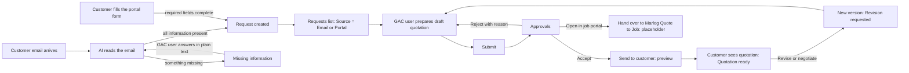
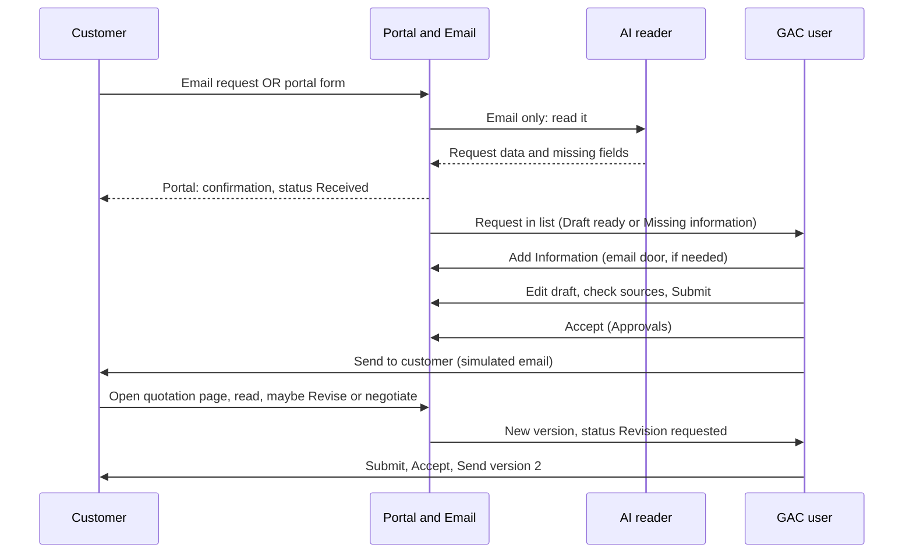
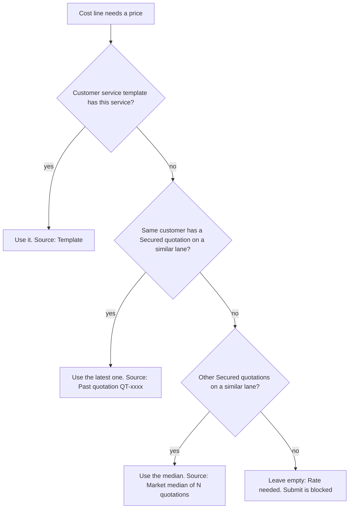
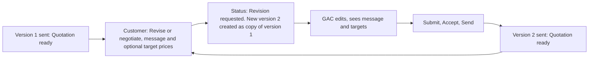

# 02 Business Flows

Plain business view. No technical detail. Diagrams are Mermaid; render them in any Mermaid viewer.

## 1. Big picture: two doors, one list

## 2. Swimlane: who does what

## 3. Request statuses

GAC side (internal): `Reading email`, `Missing information`, `Draft ready`, `Submitted`, `Accepted`, `Rejected`, `Sent to customer`, `Revision requested`.

Customer side (simple) and the mapping:

| GAC status | Customer sees |
|---|---|
| Reading email, Missing information | not visible (email door) |
| Portal request just created | Received |
| Draft ready, Submitted, Accepted, Rejected (first quotation) | Under review |
| Sent to customer | Quotation ready |
| Revision requested | Revision requested |
| After a revision is sent again | Quotation ready (new version) |

`Received` is shown for a portal request until GAC starts the first draft. The customer never sees `Rejected` or any internal word.

## 4. Draft quotation: where prices come from

Notes can add suggestions on top. A suggestion never changes a number until the GAC user presses Accept, and only on its own price basis.

## 5. Revise or negotiate loop

No limit on rounds. Earlier versions stay visible to both users.

## 6. Who sees what

| Item | Customer | GAC user |
|---|---|---|
| Request details | yes (own) | yes |
| Prices and services | only after Send | always |
| Cost, margin, operating income | never | yes |
| Price source and confidence | never | yes |
| Internal notes and reasons | never | yes |
| Customer message and target prices | yes (own) | yes |
| Versions | yes | yes |
| Rejection reason | never | yes |

## 7. Customer journey (portal)

Pick mode, fill form, Request quotation, confirmation with request number, My requests shows `Received`, later `Quotation ready`, open the quotation page, optionally Revise or negotiate.

## 8. GAC user journey

Requests list, open a row (Edit Draft or Add Information), check lines and sources, handle Notes suggestions, Submit, Approvals, Accept, Send to customer, preview, Send. On a revision: read the customer panel, edit, Submit, Accept, Send again.
